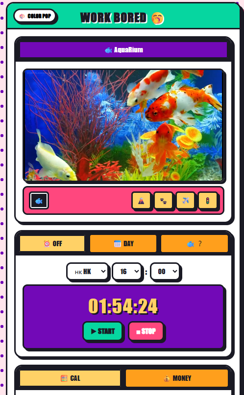

 
  
# The First wishes: Get some colors at work.

腦海第一圖示：彩色馬賽克，主要動作是鼠標上下滾輪，會有切頁，雛形架構就出來了。
第一次并不成功，因直接一股腦表述給AI。
第一次解決方法：問AI怎麽立架構，得到答案：先從骨架開始，確定内容，最後才是色彩升級。
第一次骨架是4模塊：時間👉計算器👉游戲👉水族館
AI給我的第一次建議是：把重點放到頁頭。

V.1: 顔色豐富的水族館内嵌YOUTUBE視頻，上班倒計時，不怎麽用的計算機，貪吃蛇小游戲
V.1.1: 補了個新聞抓取，因願望，可放在最底層沒迭代，需要API，待改進（Marked）
（用時幾天）

Feedback：用了幾天發現可行，也有人用，内容穩定，使用頻率不稀少

Improvement：肯定還有改進空間，纍計了3種方向，1.加幾種視頻鏈接，2.日期，3.游戲改成2048+miner
第二次不成功：日期API抓取出現不完整/道茶小游戲美工度不足SVG畫面并不豐滿。
第二次解決方案：固定日期+接下來兩年的浮動日期/捨棄游戲改成簡單版miner爭取快速簡單跑通。
流程感覺：幾天👉一晚上加速4倍，原因：有骨架，有手感，方向清晰，迅速放棄，突破電腦vs手機自我設限。

V.2:多樣化内嵌視頻，穩定日期顯示，通用互動游戲增加互動度👉提高粘性

Feedback: 停止迭代，感覺摸魚不需要太多信息攝入，選擇也不需要多，功能能沒做到極度滲入，所以暫停進一步添加。
判斷目前内容足夠使用且完成目的，節點式閉環。
Kkp決定去學習，有更好的想法再回來更新。

